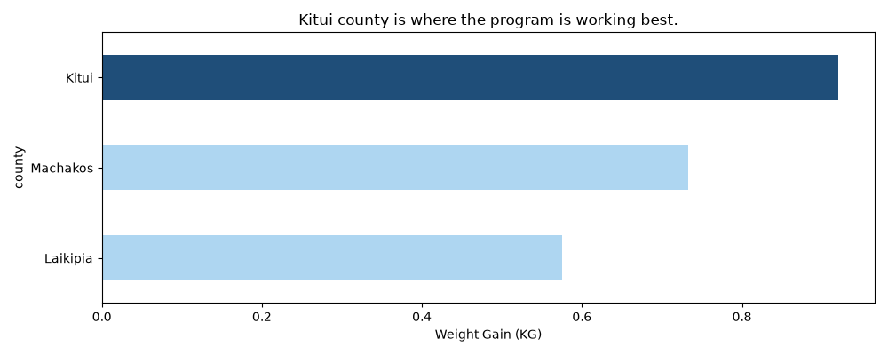
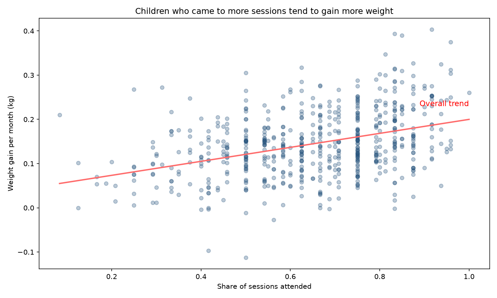
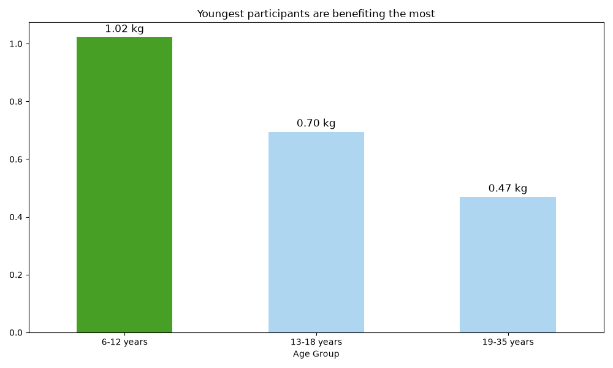

# Nutrition Program Outcomes: Data Storytelling

A six-month nutrition program run by a Nairobi NGO across three counties (Kitui, Machakos, Laikipia). This project turns the outcome data into three findings a non-technical donor can understand in a 10-minute meeting.

> The data is synthetic, generated with Python for this exercise.

## The three findings

### 1. Kitui is where the program is working best



Participnts in Kitui county gained the most weight, ahead of Machakos and Laikipia. The ranking stays the same when adjusted for how long children were enrolled. Kitui also leads when comparing participants with similar attendance, so attendance alone does not explain its results. Something about how the program runs there is worth learning from.

### 2. Children who come to more sessions tend to gain more weight



Children who attend a larger share of sessions tend to gain more. The link is real but modest: it appears in every county, and many other factors also matter. The data shows a link, not proof that attendance causes the gain.

### 3. The youngest participants are benefiting the most



The 6-12 age group gained the most, followed by 13-18 and then 19-35. Attendance was similar across the three groups, so the youngest group is not gaining more simply because they came more often.


## Setup

```bash
pip install -r requirements.txt
```

## Usage

Run the program from the project's folder where the attendance.csv file is saved. 
```
python corr.py
```

## How the analysis was done

-  `nutrition_data.py` generates 600 synthetic participants.
-  `csv_to_db.py` loads the CSV into a SQLite database. 
-  County and age-group rankings were checked in SQL as well as in Python.
-  Comparisons use weight gain per month and attendance as a share of possible sessions (4 per month).
-  The three charts are made with Matplotlib. Each chart carries one message, with the headline as its title.

## What the data cannot answer

- Why is Kitui doing better even at the same attendance level? There is no data on food availability, staffing or distance to sites.
- Is the youngest group's gain from the program or from normal growth? There is no comparison group of non-participants.
- Is weight gain the right goal for the adult group? A smaller gain may be healthy for adults.


## Pricing note

KES 85000 for data cleaning, three findings, three charts and a short-written summary. Messy records, more counties or extra questions cost more.

## Stack

- **Python**
- **Matplotlib**
- **pandas**
- **numpy**

## Files

| File | Purpose |
|---|---|
| `nutrition_data.py` | Generates the sample data |
| `csv_to_db.py` | Loads the CSV into SQLite |
| `corr.py` | Produce the charts and saves them as PNG files |
| `charts` | Folder for the three charts |
| `nutrition_data.csv` | Synthetic data | 

